# 🟢 Rick & Morty Dashboard

<p align="center"></p>

Aplikasi React Mini Dashboard yang mengintegrasikan **Rick & Morty API** (2 endpoint: Character & Location).

## ✅ Fitur Utama
- ✅ Fetch 2 endpoint berbeda (`/character` & `/location`)
- ✅ Tampilan Card/Grid responsif (Tailwind CSS)
- ✅ Fitur Search & Filter (by Status: Alive/Dead/Unknown)
- ✅ Loading State & Error Handling
- ✅ Fully Responsive (Mobile-Friendly)

## 🛠️ Teknologi
- React 18 + Vite
- Axios (HTTP Client)
- Tailwind CSS v4
- GitHub & Vercel

## 🚀 Cara Menjalankan di Lokal
```bash
# 1. Install dependencies
npm install

# 2. Jalankan server development
npm run dev

# 3. Buka browser di http://localhost:5173
